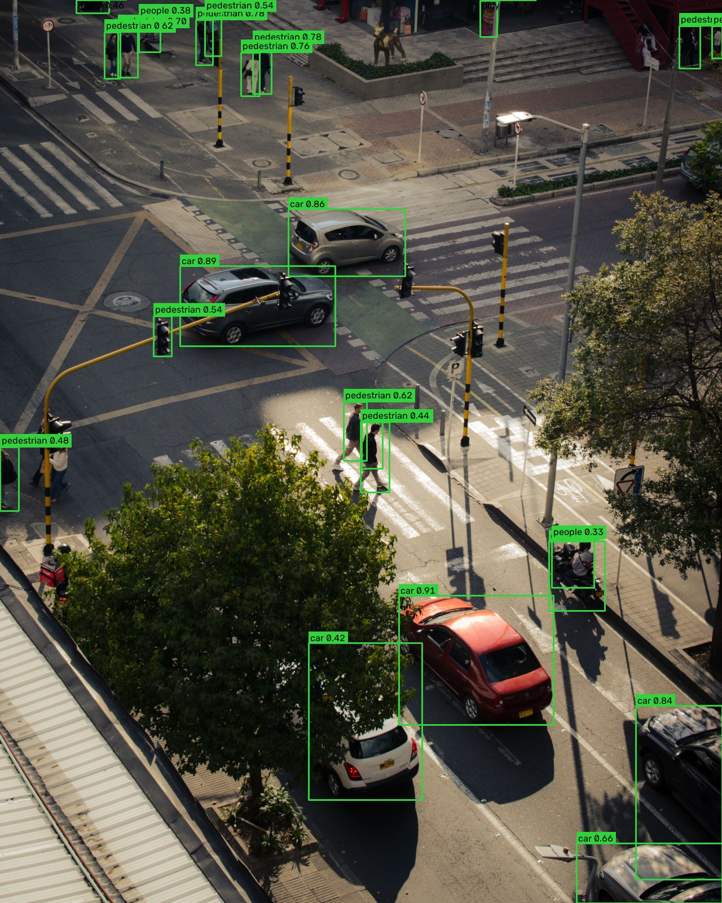
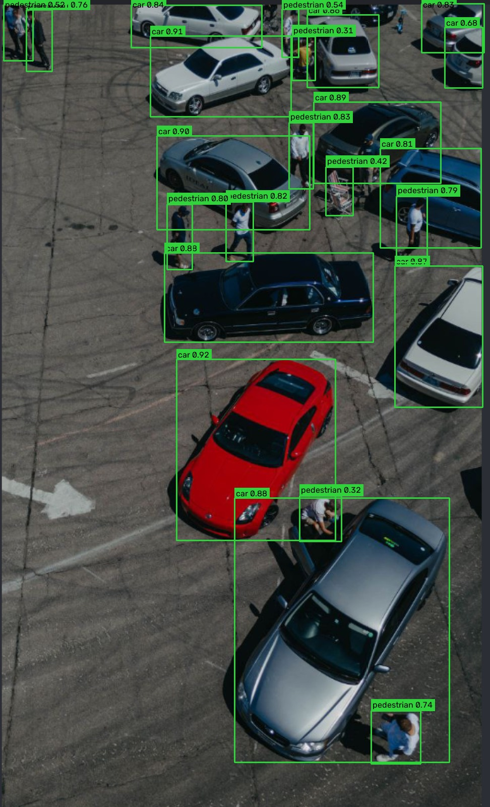
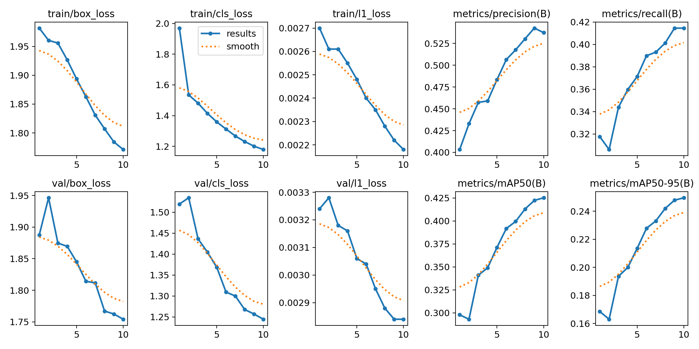
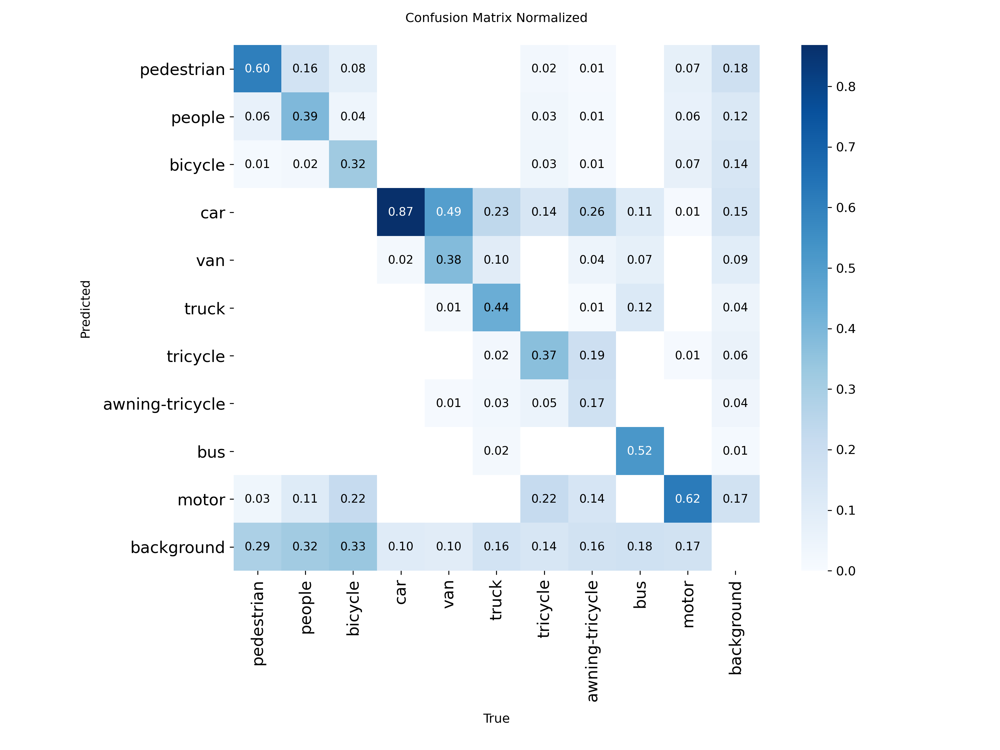
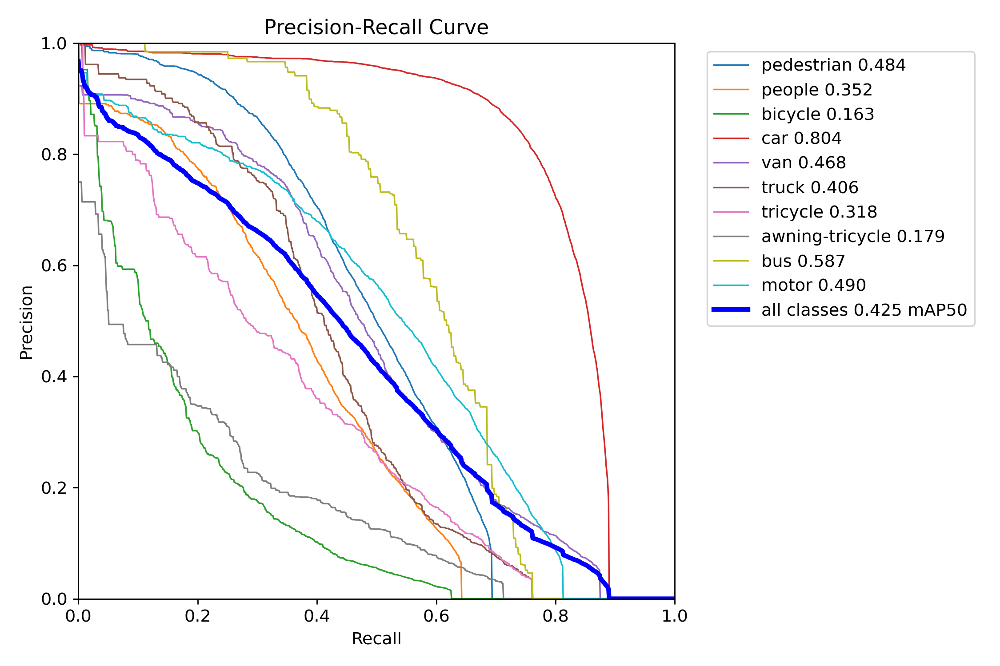

<div align="center">
  <h1>YOLO26m × VisDrone</h1>
  <p>Обнаружение людей и транспорта на снимках с высоты</p>
  <p><strong>Сначала 15 эпох при 940 px → затем 10 эпох при 640 px</strong></p>
  <p>Веса модели 640 будут опубликованы в GitHub Releases</p>
</div>

<p align="center">
  
  
</p>

<p align="center"><sub>Независимые изображения: слева 24 обнаружения, справа 23. Порог уверенности — 0.25.</sub></p>

## О проекте

Модель YOLO26m обучали на VisDrone в два запуска: сначала 15 эпох при размере 940 px, затем 10 эпох при 640 px. Она ищет пешеходов и транспорт и возвращает класс, уверенность и координаты рамки для каждого объекта. Здесь представлены скрипт, графики и метрики запуска **`yolo26m_test640`**. Его веса подготовлены для отдельной публикации в **Releases**. Файлов запуска 940 px в этом репозитории пока нет.

| Файл | Назначение |
| --- | --- |
| [`predict.py`](predict.py) | Запуск модели на своём изображении |
| [`train.py`](train.py) | Повторение второго запуска: 10 эпох при 640 px |
| [`results.csv`](results.csv) | Метрики каждой эпохи |
| [`args.yaml`](args.yaml) | Настройки исходного запуска |

## Скачать модель и запустить

После публикации релиза скачайте из вкладки **Releases** файл **`yolo26m_test640.zip`**. Распакуйте его в корень проекта: внутри архива лежит `weights/best.pt`.

```bash
python -m venv .venv
source .venv/bin/activate
python -m pip install -r requirements.txt
unzip yolo26m_test640.zip
python predict.py /path/to/image.jpg
```

Размеченное изображение появится в `runs/predict/`. По умолчанию используются `imgsz=640` и `conf=0.25`; параметры можно изменить через `--imgsz` и `--conf`.

## Качество модели 640 на проверочной выборке

Показатели после 10-й эпохи:

| Precision | Recall | mAP@50 | mAP@50:95 |
| ---: | ---: | ---: | ---: |
| 0.537 | 0.415 | 0.425 | 0.250 |

`mAP@50:95` оценивает рамки строже, чем `mAP@50`. Исходные значения без округления доступны в [`results.csv`](results.csv).

### Как шёл запуск 640



За 10 эпох этого запуска ошибки на обучающей и проверочной выборках снижались, а precision, recall и mAP росли. График не содержит данные первого запуска на 940 px.

<details>
<summary><strong>Матрица ошибок и PR-кривая</strong></summary>

<p align="center">
  
  
</p>

</details>

## Повторить запуск 640

```bash
python train.py --data VisDrone.yaml --device 0
```

Скрипт повторяет параметры второго запуска: 10 эпох, размер 640 px, batch 16, seed 42. Для видеокарты с меньшим объёмом памяти можно задать `--batch 8`. Параметры первого запуска на 940 px здесь не восстанавливаются: его конфигурации и весов в доступных файлах нет. Датасет не включён в репозиторий.

<sub>Код использует Ultralytics; изображения VisDrone и исходные предобученные веса имеют собственные условия использования.</sub>
